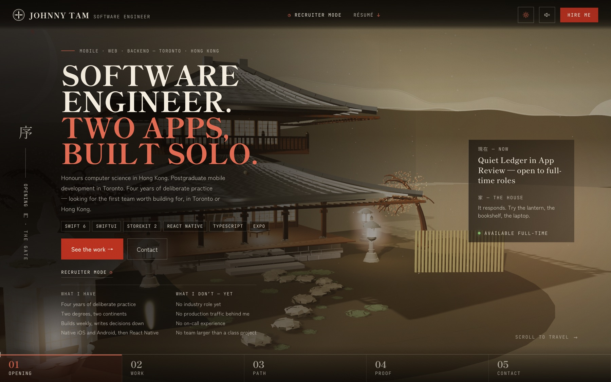

# Johnny Tam — Software Engineer

**Mobile, web & backend.** Two apps designed and built solo — one in Apple App Review, one in TestFlight.

**Live site:** _link coming soon_ · [Résumé (PDF)](public/Johnny-Tam-Resume.pdf) · [LinkedIn](https://www.linkedin.com/in/johnny-tam-b9374a246/) · [Email](mailto:tamtingyuen@gmail.com)

- **Available full-time** — replies within a day
- **Based in** Toronto, ON or Hong Kong — open to either
- **In a hurry?** The live site has a **Recruiter mode** that puts everything on one page.

---

## Selected work

### Quiet Ledger — budgeting without a bank login
**In App Review** (iPhone & iPad) · Solo — design, build, ship · Jun – Oct 2026
`React Native` `Expo` `TypeScript` `Supabase` `TanStack Query` `RevenueCat`

Most budgeting apps want your bank login, your attention, or both. Quiet Ledger answers one question — *can I spend this today?* You log entries yourself; budgets, recurring bills and savings goals live on one quiet screen behind Face ID.

| ~11K | 6 / 6 | 0 |
|:--|:--|:--|
| lines of TypeScript | Postgres tables behind row-level security | bank logins or ads |

**Decisions**
- **One number up front** — what's left to spend today: monthly budget ÷ days remaining, recomputed on every entry.
- **Manual entry over bank sync** — no third-party credentials to store, nothing to break when a bank changes its API.
- **Atomic money moves** — transfers run as Postgres functions, so a dropped connection can't leave half a write.
- **Row-level security everywhere** — one user can never read another's ledger, even with a leaked key.

**Outcome:** feature-complete, with RevenueCat subscriptions, PDF/CSV export and a full account-deletion flow for App Store compliance.
**Lesson:** shipping is mostly not code — the Paid Apps agreement, subscription metadata and signed QA held up the launch more than any bug.

> Try a working copy of its core loop in the browser: open the live site, then **Work → ▶ Demo**.

### Focus Coach — your calendar, protected from your phone
**TestFlight testing** · Solo — design and build · 2026 – now
`Swift 6` `SwiftUI` `EventKit` `Screen Time API` `StoreKit 2` `On-device AI`

The gaps between meetings are where real work should happen — and exactly where the phone takes over. Calendar tools protect that time on paper but can't stop the scrolling; app blockers stop the scrolling but don't know your calendar. Focus Coach does both: it plans focus blocks in the gaps between meetings, then pauses distracting apps during them.

| ~6K | 61 | 0 |
|:--|:--|:--|
| lines of Swift | unit tests on the planning core | servers or accounts |

**Decisions**
- **Read the calendar, don't replace it** — EventKit finds the free windows each weekday; nothing to import or sync.
- **Commit once, then hands off** — DeviceActivity schedules each block, and ManagedSettings shields the chosen apps only while it runs.
- **On-device only** — no backend means no account, no data to leak, and nothing to keep running. App Store label: "Data Not Collected".
- **A testable core** — block sizing, meeting buffers and re-planning live in a separate Swift module with 61 unit tests, no UI needed.

**Outcome:** core loop built and in TestFlight, with a StoreKit 2 subscription and free trial.
**Lesson:** Apple's Screen Time APIs are powerful but tightly sandboxed — most of the design work was deciding what the app is allowed to know.

> The source code for both apps is private. Happy to walk through it in an interview.

---

## Skills

- **Built & shipped with:** Swift 6 · SwiftUI · StoreKit 2 · React Native · TypeScript · Expo · Supabase · PostgreSQL · TanStack Query · RevenueCat
- **Languages:** JavaScript · Python · Java · Kotlin · SQL
- **Web & backend:** Node.js · REST APIs · Firebase · Google Cloud
- **Workflow:** Git · CI/CD · unit testing · code review · Agile/Scrum · Claude Code · Copilot

## Education

- **Postgraduate Certificate, Mobile Application Development & Strategy** — George Brown College, Toronto (2023–24) · Dean's Honour List
- **BSc (Hons) Computer Science** — Hong Kong Metropolitan University (2020–23) · Dean's Honour List
- **Scrum Fundamentals** — SCRUMstudy Canada (2024)

**Before code:** warehouse supervisor at Hactl (2018–20) · peer tutor at HKMU.

---

## About this site

The portfolio itself is a small piece of front-end work:

- **A 3D house built in code** — every roof tile, lantern and leaf is generated with three.js; there are no 3D model files.
- **Five chapters on a sideways reel** on desktop, a normal scrolling page on phones, and a one-page **Recruiter mode** for a quick read.
- **An in-browser demo** of Quiet Ledger's add-an-expense loop, built as part of the page.
- **Usable by keyboard**, with focus kept inside pop-ups; tested in Chrome on desktop, tablet and phone sizes, and in Safari on iPhone.

Built with React, Vite and three.js. The visual design started in Claude Design and was turned into this React code with Claude Code's help; I directed, reviewed and tested it.

## Contact

[Email](mailto:tamtingyuen@gmail.com) · [LinkedIn](https://www.linkedin.com/in/johnny-tam-b9374a246/) · [GitHub](https://github.com/Johnny-1211) · [Résumé (PDF)](public/Johnny-Tam-Resume.pdf)
